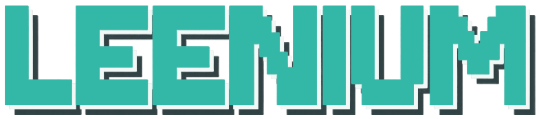
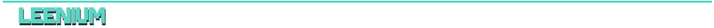

<div align="center">



**A static dark website for the shared Leenium palette and product ecosystem.**

Hosted under `github.com/drunkleen/leenium.webpage`.

</div>

---

## Features

- **Shared palette** - the site follows the same Leenium colors used across the ecosystem
- **Dark-only UI** - built around a single low-glare visual language
- **Static HTML/CSS** - no framework, no build step
- **Local assets** - logos, favicon, and loader are all shipped in the website folder

---

## Pages

- Home
- Palette
- VS Code
- Neovim
- Firefox
- OpenCode
- Ghidra
- Omarchy
- Waybar
- Limine
- Hyprlock
- Plymouth

---

## Color Palette

| Role | Hex | Swatch |
|---|---|---|
| Background | `#0b1113` |  |
| Panel | `#11191c` |  |
| Popup | `#182326` |  |
| Line / Border | `#223033` |  |
| Active | `#304144` |  |
| Selection | `#365156` |  |
| Foreground | `#d8e3e0` |  |
| Muted | `#718688` |  |
| Accent (Teal) | `#33b8a8` |  |
| Cyan | `#59d6c5` |  |
| Emerald | `#4dba7a` |  |
| Sea Bright | `#67cf94` |  |
| Type | `#71e4d8` |  |
| Warn | `#d9c76b` |  |
| Warn Bright | `#efd45e` |  |
| Orange | `#f4a259` |  |
| Error | `#e16f73` |  |
| Error Soft | `#f08787` |  |
| Blue | `#5e9bff` |  |
| Void | `#020405` |  |
| Sidebar | `#0e1518` |  |
| Card | `#141e21` |  |
| Floating | `#1d2a2d` |  |

---

## What It Uses

- **Static HTML/CSS** - no framework, no build step
- **Local assets** - logos, favicon, and loader are all shipped in the website folder
- **Product previews** - each tool page links back to its own Leenium theme

---

## Local Preview

Open `index.html` directly in a browser, or serve the folder with any static file server.

```bash
python -m http.server
```

Then open the local address shown in the terminal.

---

## Notes

- The palette page is the source of truth for the website colors.
- Product pages link back to the matching Leenium themes and previews.
- The site is intentionally minimal and hand-authored.

---

## The Leenium Ecosystem

Leenium is a unified dark desktop environment built around the shared palette. Explore the full ecosystem at [leenium.drunkleen.com](https://leenium.drunkleen.com).



<p align="center">
    Copyright &copy; 2026-present <a href="https://github.com/drunkleen" target="_blank">LEENIUM</a>
</p>
<p align="center">
    <a href="https://github.com/drunkleen/leenium.webpage/blob/master/LICENSE">
        
    </a>
</p>